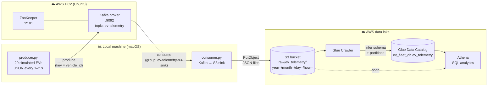

# Real-Time EV Fleet Telemetry & Charging Pipeline

A real-time streaming data pipeline on AWS that tracks a fleet of 20 electric
vehicles: battery level and temperature, speed, GPS location and charging-station
status. Events stream through Apache Kafka into an S3 data lake and are queried
with SQL in Amazon Athena, for example to find overheating batteries or overloaded
charging stations.

## Architecture



| Stage | Technology | What it does |
|-------|------------|--------------|
| Ingest | `src/producer.py` + `kafka-python` | Simulates 20 EVs driving, parking and charging around Boston; sends one reading per vehicle every 1–2 s |
| Stream | Apache Kafka 3.9 on EC2 | Durable, ordered buffer (3 partitions, keyed by `vehicle_id`) |
| Land | `src/consumer.py` + `boto3` | Writes events to S3 as JSON, Hive-partitioned by event time |
| Catalog | AWS Glue Crawler | Infers the schema and registers partitions as a table |
| Query | Amazon Athena | Serverless SQL over the files in S3 |

## Project structure

```
ev-fleet-telemetry-pipeline/
├── README.md
├── requirements.txt
├── .env.example               # copy to .env and fill in (never commit .env)
├── .gitignore
├── src/
│   ├── config.py              # reads settings from .env
│   ├── producer.py            # EV simulator -> Kafka
│   └── consumer.py            # Kafka -> S3 (or local folder)
├── scripts/
│   ├── ec2_setup_commands.sh  # Java + Kafka + ZooKeeper install on Ubuntu EC2
│   └── setup_glue_athena.sh   # one-command Glue crawler + Athena test queries
├── sql/
│   └── athena_queries.sql     # analysis queries
└── docs/
    └── aws_console_guide.md   # Security Group, EC2, S3, IAM, Glue, Athena setup
```

## Event schema

One JSON message per vehicle per tick:

```json
{
  "event_id": "5b0c6f0e-3f1a-4b7e-9a51-2a8f3c1d9e44",
  "vehicle_id": "EV-007",
  "timestamp": "2026-11-16T20:31:05.123Z",
  "battery_level": 63.4,
  "battery_temp_c": 47.8,
  "speed_mph": 42.1,
  "charging_status": "NOT_CHARGING",
  "station_id": null,
  "location": {"lat": 42.349712, "lon": -71.078604}
}
```

| Field | Type | Notes |
|-------|------|-------|
| `event_id` | string (UUID) | Unique per reading; use it to deduplicate |
| `vehicle_id` | string | `EV-001` … `EV-020`; also the Kafka message key |
| `timestamp` | string (ISO-8601, UTC) | Event time; drives the S3 partition |
| `battery_level` | double | State of charge, 0–100 % |
| `battery_temp_c` | double | Battery pack temperature; **> 45 °C is an overheat alert** |
| `speed_mph` | double | 0 while parked or charging |
| `charging_status` | string | `NOT_CHARGING`, `CHARGING` (AC), `FAST_CHARGING` (DC), `FULLY_CHARGED` |
| `station_id` | string or null | Set only while plugged in |
| `location` | struct `{lat, lon}` | Query in Athena as `location.lat` |

**Built-in scenarios for analysis**

- **Overheating:** `EV-007` and `EV-014` have a simulated faulty cooling system and
  spike above 45 °C every minute or so; any vehicle can rarely spike too. Fast
  charging also runs batteries hotter.
- **Station overload:** drivers pick stations by popularity with no reservation
  system, so small, busy stations such as `ST-CAM-01` (Kendall, 2 ports) and
  `ST-BOS-02` (Fenway, 2 ports) regularly end up with more cars than ports.
- Battery drain and charging are sped up (~20×) so full cycles happen within minutes.

## Getting started (macOS)

### 1. Prerequisites

```bash
brew install python awscli
```

You also need an AWS account. Then follow
[docs/aws_console_guide.md](docs/aws_console_guide.md) to create the Security Group,
EC2 instance, S3 bucket and IAM credentials (`aws configure`).

### 2. Python environment

```bash
cd ev-fleet-telemetry-pipeline
python3 -m venv .venv
source .venv/bin/activate
pip install -r requirements.txt
cp .env.example .env        # then edit .env: EC2 IP and bucket name
```

### 3. Try the producer locally (no Kafka or AWS needed)

```bash
python src/producer.py --dry-run --ticks 3
```

### 4. Start Kafka on EC2

```bash
scp -i ~/.ssh/ev-kafka-key.pem scripts/ec2_setup_commands.sh ubuntu@<EC2_PUBLIC_IP>:~
ssh -i ~/.ssh/ev-kafka-key.pem ubuntu@<EC2_PUBLIC_IP>
bash ec2_setup_commands.sh
```

The script prints the `KAFKA_BOOTSTRAP_SERVERS` value to put in `.env`.

### 5. Run the pipeline (two Terminal tabs, venv activated in each)

```bash
# Tab 1: stream telemetry into Kafka
python src/producer.py
```

```bash
# Tab 2: sink Kafka into S3
python src/consumer.py
```

To test without S3, write the same folder layout to disk instead:

```bash
python src/consumer.py --local-dir data
```

Check that files are arriving:

```bash
aws s3 ls s3://<your-bucket>/raw/ev_telemetry/ --recursive | tail
```

Stop either script with `Ctrl+C`; the consumer finishes writing its current batch
before exiting.

### 6. Catalog and query

**Option A: one command (AWS CLI).**

```bash
./scripts/setup_glue_athena.sh
```

The script creates the Glue crawler's IAM role, the `ev_fleet_db` database and the
crawler (skipping any that already exist), runs the crawl, prints the table schema and
then runs a few Athena test queries. It needs AWS credentials that can manage IAM roles,
Glue and Athena, so the S3-only key used by the consumer is not enough. Override the
defaults with `AWS_REGION=... BUCKET=... ./scripts/setup_glue_athena.sh`.

**Option B: AWS Console.** Run the Glue Crawler, then the queries in
[sql/athena_queries.sql](sql/athena_queries.sql) in the Athena query editor
(steps 6–7 of the [console guide](docs/aws_console_guide.md)).

## Results

Output from a first end-to-end run on AWS (`us-east-2`), queried in Athena after the
Glue crawl.

**Completeness check:** 280 events, exactly 20 vehicles × 14 readings each, all in one
hourly partition (`year=2026/month=11/day=17/hour=08`). Nothing was lost between
Kafka and S3.

**Readings by charging status**

| charging_status | readings | avg battery % |
|-----------------|---------:|--------------:|
| `NOT_CHARGING`  | 236 | 63.0 |
| `FAST_CHARGING` | 31  | 57.3 |
| `CHARGING`      | 13  | 77.5 |

<details>
<summary>Per-vehicle statistics (all 20 vehicles)</summary>

| vehicle_id | readings | avg battery % | min battery % | avg battery temp °C | avg speed mph | max speed mph |
|------------|---------:|--------------:|--------------:|--------------------:|--------------:|--------------:|
| EV-001 | 14 | 51.3 | 30.3 | 29.4 | 3.6  | 50.2 |
| EV-002 | 14 | 71.2 | 42.5 | 29.9 | 49.6 | 75.0 |
| EV-003 | 14 | 60.0 | 42.3 | 24.8 | 1.5  | 20.8 |
| EV-004 | 14 | 36.3 | 27.4 | 27.6 | 14.0 | 50.3 |
| EV-005 | 14 | 48.6 | 40.3 | 28.3 | 26.1 | 42.5 |
| EV-006 | 14 | 69.8 | 34.2 | 26.1 | 15.6 | 52.8 |
| **EV-007** | 14 | 68.6 | 29.4 | **30.4** | 29.2 | 50.1 |
| EV-008 | 14 | 45.4 | 25.1 | 28.8 | 20.2 | 37.2 |
| EV-009 | 14 | 78.7 | 29.8 | 26.1 | 3.3  | 46.1 |
| EV-010 | 14 | 73.6 | 55.7 | 28.5 | 46.3 | 75.0 |
| EV-011 | 14 | 83.3 | 41.0 | 30.2 | 11.6 | 42.5 |
| EV-012 | 14 | 66.2 | 42.3 | 27.5 | 26.2 | 41.3 |
| EV-013 | 14 | 47.8 | 40.4 | 28.9 | 29.1 | 55.8 |
| **EV-014** | 14 | 46.8 | 29.0 | **30.8** | 33.7 | 48.1 |
| EV-015 | 14 | 79.0 | 54.9 | 27.5 | 11.0 | 34.3 |
| EV-016 | 14 | 50.9 | 30.9 | 29.1 | 4.9  | 37.3 |
| EV-017 | 14 | 70.2 | 42.8 | 27.4 | 10.9 | 30.6 |
| EV-018 | 14 | 57.5 | 28.0 | 27.2 | 10.2 | 36.0 |
| EV-019 | 14 | 72.0 | 66.4 | 27.8 | 26.6 | 51.5 |
| EV-020 | 14 | 83.2 | 40.9 | 26.0 | 11.7 | 51.2 |

</details>

**What the data shows:** EV-014 (30.8 °C) and EV-007 (30.4 °C), the two vehicles
simulated with a faulty battery-cooling system, have the highest average battery
temperatures in the fleet. The injected fault is visible end to end, from the producer
through Kafka and S3 to a SQL query. With only 14 readings per vehicle the gap is small
(EV-011 follows at 30.2 °C); a longer run makes it clearer, and
[query 1](sql/athena_queries.sql) lists every reading above the 45 °C threshold.

## Design decisions

- **Partitioning by event time** (`year=/month=/day=/hour=`, UTC): Athena reads only the
  partitions named in the `WHERE` clause, which cuts both query time and cost.
- **Kafka key = `vehicle_id`:** all readings for one vehicle go to the same partition,
  so they stay in order.
- **At-least-once delivery:** the consumer commits Kafka offsets only after its files are
  in S3. A crash can cause a few duplicates but never silent data loss;
  deduplicate on `event_id` if needed.
- **File size vs. latency:** `BATCH_SIZE=1` writes one file per event, which is easy to
  inspect but creates many tiny files (slow, costlier Athena scans and many S3 PUTs).
  For heavier workloads set `BATCH_SIZE=500` or more; `FLUSH_INTERVAL_SECONDS` caps how
  long events wait in the buffer.
- **Least-privilege IAM:** each identity gets only what its job needs. The consumer's
  IAM user can list the bucket and read/write its objects, nothing else (no IAM, EC2 or
  other buckets). The Glue crawler's role gets the AWS-managed Glue service policy plus
  read-only access to `raw/` in this bucket. Kafka port 9092 is open only to your own IP.
- **Configuration in `.env`:** no IPs, bucket names or credentials in code. AWS keys come
  from `aws configure` (`~/.aws/credentials`), outside the repository.

## Possible extensions

- Convert raw JSON to partitioned **Parquet** with a Glue ETL job or Athena CTAS for
  10–100× cheaper scans.
- Replace the crawler with **partition projection** so new hours are queryable instantly.
- Real-time alerts: a second consumer group that posts to Slack/SNS when
  `battery_temp_c > 45`.
- Dashboard on top of Athena with **Amazon QuickSight** or Grafana.
- Run Kafka on **Amazon MSK** and the consumer on ECS/Lambda for a managed setup.

## Cleanup

Terminate the EC2 instance and delete the S3 bucket, Glue crawler/database and IAM
access key when you're done. See step 8 of the [console guide](docs/aws_console_guide.md).

The Glue resources can also be removed from the CLI (deleting the database also deletes
its tables):

```bash
aws glue delete-crawler --name ev-telemetry-crawler --region us-east-2
aws glue delete-database --name ev_fleet_db --region us-east-2
```
